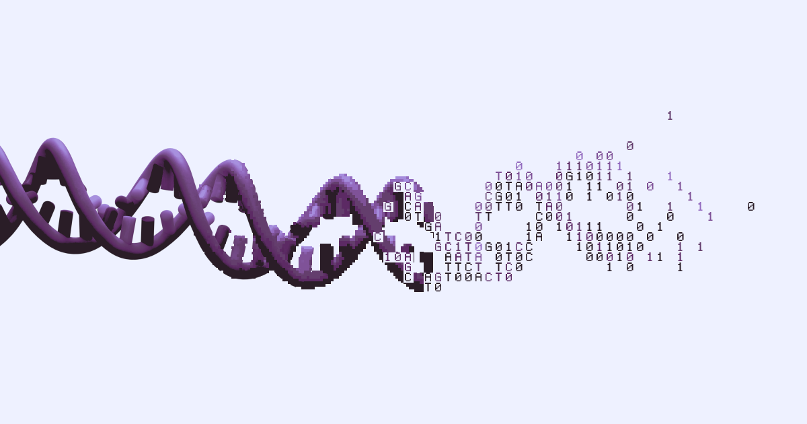
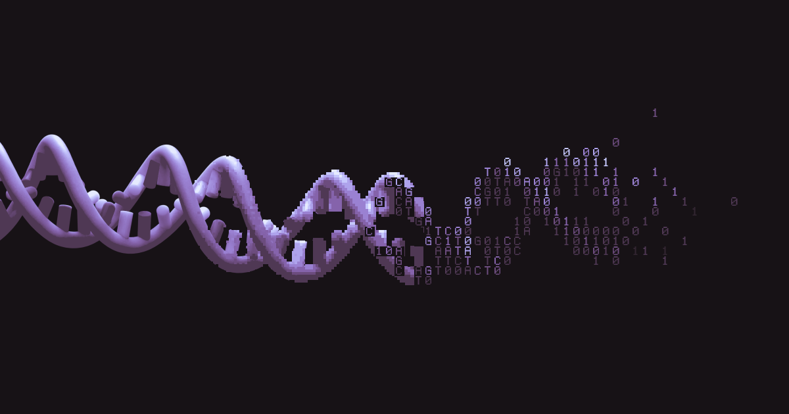
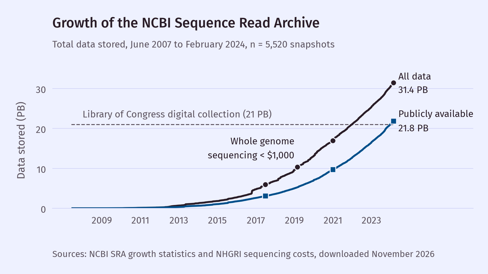
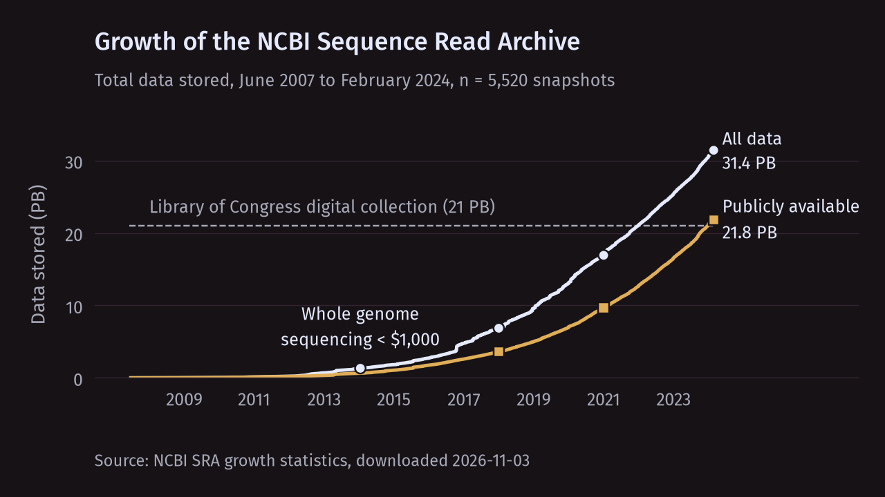

```{=html}
<figure class="ng-fig site-loop" id="dna-spin">
  <video width="1200" height="630" muted loop playsinline preload="none"
         aria-label="A DNA helix turning as it breaks into base letters, then ones and zeros"></video>
  <button type="button" class="ng-field__toggle">Pause</button>
  <noscript>
    
    
  </noscript>
</figure>
<script>
/* Plays the light or dark loop to match the site theme (switching when it changes).
   Reduced motion: the still poster only, nothing downloaded. Click the loop, or the
   focus-only button, to pause/play. AV1 WebM first, H.264 MP4 for other browsers. */
(function () {
  var fig = document.getElementById("dna-spin");
  var v = fig.querySelector("video"), btn = fig.querySelector("button");
  var root = document.documentElement;
  var still = window.matchMedia("(prefers-reduced-motion: reduce)");
  var paused = false;
  v.muted = true;
  function load() {
    var name = "dna-spin-" + (root.getAttribute("data-theme") === "dark" ? "dark" : "light");
    v.poster = name + "-poster.webp";
    v.innerHTML = still.matches ? "" :
      '<source src="' + name + '.webm" type=\'video/webm; codecs="av01.0.05M.08"\'>' +
      '<source src="' + name + '.mp4" type="video/mp4">';
    btn.hidden = still.matches;
    btn.textContent = "Play";          /* becomes "Pause" only once it really plays */
    v.load();
    if (!still.matches && !paused) v.play().catch(function () {});
  }
  /* Follows the video's real state, so a browser that blocked autoplay starts it on the first click. */
  function toggle() {
    if (still.matches) return;
    if (v.paused) { paused = false; v.play().catch(function () {}); }
    else { paused = true; v.pause(); }
  }
  v.addEventListener("play", function () { btn.textContent = "Pause"; });
  v.addEventListener("pause", function () { btn.textContent = "Play"; });
  v.addEventListener("click", toggle);
  btn.addEventListener("click", toggle);
  new MutationObserver(load).observe(root, { attributes: true, attributeFilter: ["data-theme"] });
  if (still.addEventListener) still.addEventListener("change", load);
  load();
})();
</script>
```

## Bioinformatics is...

> An interdisciplinary field that develops computational methods and software tools to analyze and interpret complex biological datasets using biology, computer science, mathematics, and statistics.

When I am asked what I do for a living, I often reach for multiple descriptions that are more familiar to people outside the sciences: "Computational Biology", "Biology Research", "Data Science". None of them are quite right, and in the current age of AI, the question has become harder to answer because it is frequently followed by a second: will the field still exist? Bioinformatics has always been a highly interdisciplinary field, and because of our position at the intersections of those disciplines, communicating what it is has always been difficult. This post is my view of what the field is. The definition above describes it as the development of methods and tools. I think that excludes an important part, which is the judgment about how the data were generated and whether an analysis of them can be trusted. I hope this post is useful to those considering a career in bioinformatics or to bioinformatics professionals considering the impact of AI on the field.



## Was biology late to the computation party?

Mathematics and physics were the first fields to adopt computation, and perhaps that is why those fields do not have such a strong separation between researchers who use computer programming and those that do not. This could imply that eventually there will be no such separation in the biological sciences. Another factor is that our understanding of biological systems lagged behind the development of computers. ENIAC (1945) was the first general-purpose electronic computer and was created to perform physics calculations for the U.S. military. It would be another 7 years before DNA was confirmed to be the genetic material [@hershey1952], and another 6 after that before the first bioinformatics software was written [@gauthier2019].

Margaret Dayhoff and Robert Ledley wrote COMPROTEIN in 1958 to solve a specific problem with our ability to measure the full sequence of proteins. Edman peptide sequencing could read out the sequence of 50-60 amino acid pieces of a protein, and solving the full sequence required overlapping those pieces essentially by hand [@gauthier2019]. Dayhoff and Ledley both saw the promise of computational approaches in biochemistry and created the first *de novo* sequence assembly algorithm in FORTRAN [@dayhoff1962]. The protein sequences themselves could now be the subject of research questions, and this resulted in an entirely new discipline (paleogenetics) dedicated to understanding the temporal and species divergence of these sequences [@pauling1963]. Paleogenetics itself then required the development of more algorithms and software to handle the unique challenges imposed by the size and diversity of protein sequences and, later on, DNA.

So was biology late to the party? Perhaps a little, but it is more accurate to say that our ability to measure biological systems in the same systematic way that we measured physical systems did not keep pace with the developments in computer technology. As we developed new ways of measuring biology, we required an increasing number of researchers dedicated to computational analysis of those measurements. Computational analysis, after all, requires a firm understanding of the data generation process, and the data generation process in the field of biology is arguably the most complex one humanity has ever observed.

## The sequence data explosion

In the 1990s the Human Genome Project spent $2.7 billion (in 1991 dollars) to sequence the entire human genome [@gauthier2019; @nhgri-cost], driven by the promise of genomic medicine. Its biggest supporters did overpromise. Instead of the direct links between genes and common diseases that were expected to set off the mass development of gene-based therapies, we discovered the complexity of genetic interactions [@ruffo2025]. Nonetheless, genomics has made a considerable impact on human health. Genomics is now routinely used in healthcare to analyze tumor genomes (which has enabled the development of targeted therapeutics), to screen pregnancies noninvasively, and to test for pediatric conditions and rare disorders [@green2020]. Screening cell-free DNA in maternal blood can detect more than 99% of fetuses with trisomy 21 [@gil2017], and a pilot of genome sequencing in the U.K. health care system made genetic diagnoses in 25% of probands with undiagnosed rare diseases [@genomes100k2021].

In 2001 [@lander2001; @venter2001], the Human Genome Project was completed [kind of—see: @nurk2022], and just 18 years later the cost to sequence a human genome dropped to $1,000 [@wetterstrand2023], which quickly led to an exponential increase in the amount of sequencing data.

```{=html}
<figure class="ng-fig">
  
  
  <figcaption>NCBI Sequence Read Archive storage, n = 5,520 snapshots, Jun 2007 to Feb 2024.</figcaption>
</figure>
```


This increase in just sequencing data alone required the development of new analysis methods, new computational infrastructure, and new statistical methods. It was not technically feasible for biologists to develop the molecular biology needed to produce and contextualize this massive amount of data in addition to the algorithms, software, and statistical methods needed to analyze the data. The diversity of the biological data and research questions required a corresponding diversity of bioinformatics focus areas, which is another big reason it is difficult to use more precise language when trying to define the whole field of bioinformatics.

## Strange new worlds

The sequence data explosion is a story about volume, but the bigger change has been in *what* we can measure rather than *how much*. In 2016, spatial transcriptomics measured gene expression across the whole tissue section by RNA sequencing and recorded where in the tissue each measurement came from, which made it possible to analyze which genes vary with position in the tissue [@stahl2016]. Just one year later, the Cell Atlas integrated transcriptomics and antibody-based microscopy to map 12,003 human proteins to 30 subcellular structures and found that about half of those proteins localize to multiple compartments of the cell [@thul2017]. One year after that, a new light-sheet microscope captured the mouse embryo from gastrulation to the early formation of organs at the cellular level, but the microscope alone was not enough. Following those cells across the entire embryo required a new computational framework [@mcdole2018].

From a compartment of a cell to an entire embryo, these measurements sound like science fiction, and it is why I believe we are in the golden age of biological research. Each of these advances in biological assays also required people who could connect the analysis to how the data was generated. As our ability to measure biological systems at multiple levels of granularity increases, so does the need for bioinformaticians who can translate those measurements into biologically meaningful claims that expand our understanding of biology and human health. These technologies are also creating new fields of biology and new specializations within bioinformatics. Spatial biology, for example, is a rapidly growing field with its own analysis methods and software [@dries2021; @palla2022] and there are bioinformaticians who specialize in it.

## Is this the end?

Lately, the most common question I am asked by people interested in studying bioinformatics is whether LLMs are making the field obsolete. This is not the first time the question has come up. It was once thought that biology would integrate computational analysis so heavily that the two fields would no longer have a meaningful separation [@brown2014; @stevens2013]. That did not happen, because bioinformatics has never been just about running routine pipelines. Many biologists do run standardized pipelines, but our ability to perform multimodal, high-dimensional measurements is increasing at such a pace that many newer assays have no standardized pipeline at all. Those that do still rely on default settings that assume things about the experiment, such as normalization methods that assume most genes do not change between conditions, and someone has to recognize when a particular experiment breaks those assumptions.

The number of assays and the types of mathematics needed to analyze them continues to grow, which is a challenge for bioinformaticians who would typically rely on existing methods. It is especially challenging if they rely on AI for method development, since that might restrict the space of scientific exploration and bias new methods toward approaches that are already well established [@messeri2024; @hao2026].

LLMs change how quickly the code gets written; they do not change how we know whether the result is right. A mathematical proof can be verified by a machine, so a system can generate thousands of attempts and keep the one that passes. An analysis of biological data has no such check. Its correctness depends on assumptions about how the data were generated: how the samples were collected, what the assay captures and what it misses, and which sources of variation are biological versus technical. Nothing in the code or the data records whether those assumptions hold. A script will run without error and return a p-value regardless of whether the treatment groups were processed in separate batches [@leek2010].

Unlike attempting to solve mathematical proofs, generating more attempts at analyzing biological data does not guarantee that the correct analysis will be identified. Trying many analyses and keeping the one that gives a significant result inflates false positives [@simmons2011], and AI tools lower the cost of doing this. There is an exception: problems with a known correct answer can be solved by generating candidate methods and scoring them, for example, protein structure prediction [@jumper2021]. However, most of what we do is inference, where no correct answer exists to compare against.

None of this is an argument against using AI. Coding assistants have removed many of the barriers to developing and maintaining bioinformatics software that follows software engineering best practices, and I expect that to leave more time for developing methods that support rigorous, reproducible claims. The definition at the top of this post describes bioinformatics as the development of methods and tools. I would add that it is also the judgment about how the data were generated, which is what makes those methods and tools trustworthy. Developing, expanding, and sustaining that judgment is the central challenge for bioinformaticians in the age of AI. If this is the golden age of biological research, the people who can tell a real discovery from an artifact of the data or of a misspecified model have never been more important.

## References

::: {#refs}
:::
